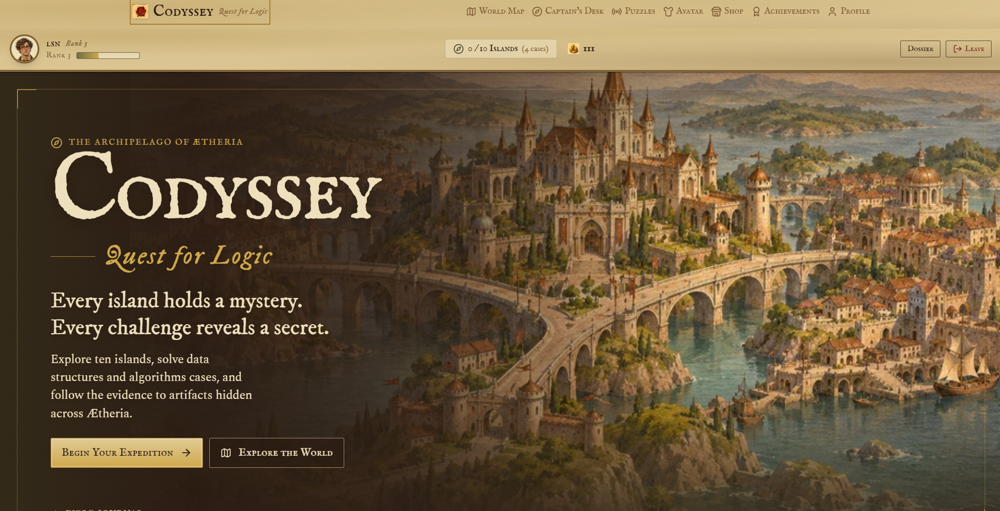
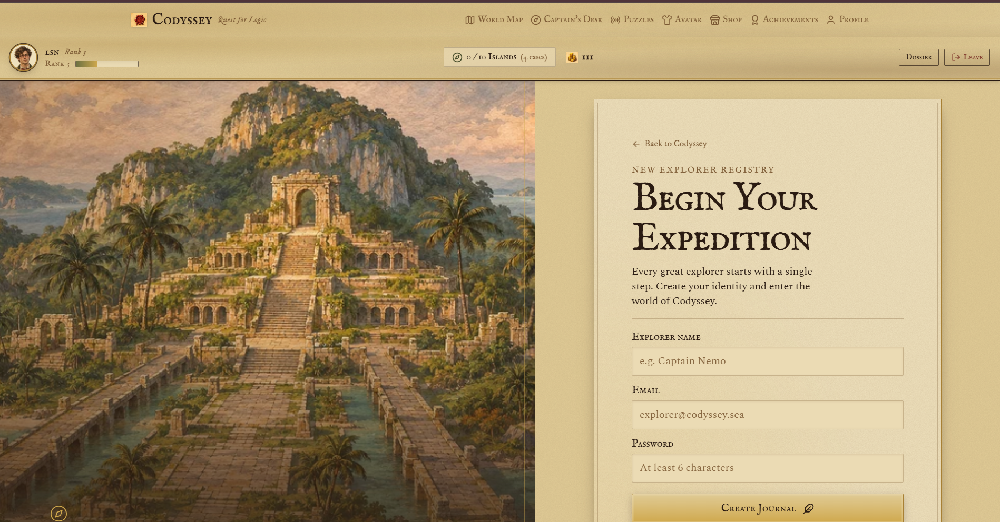
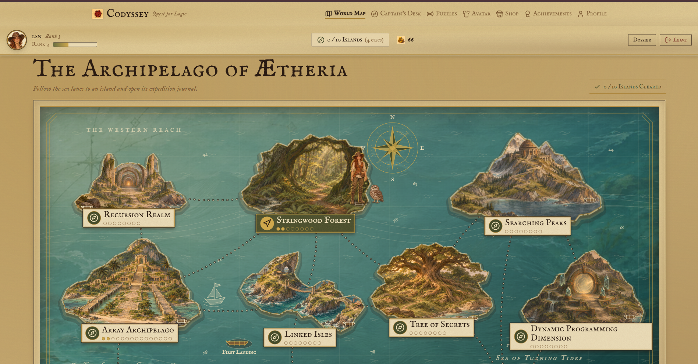
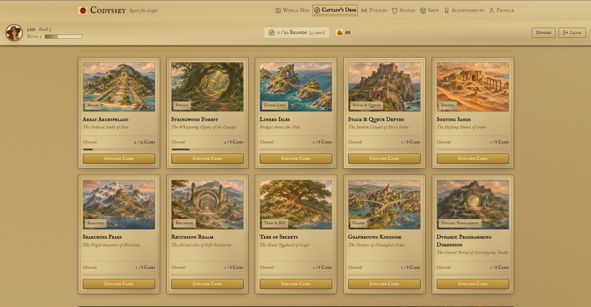
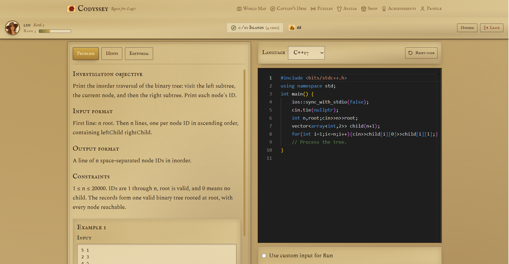
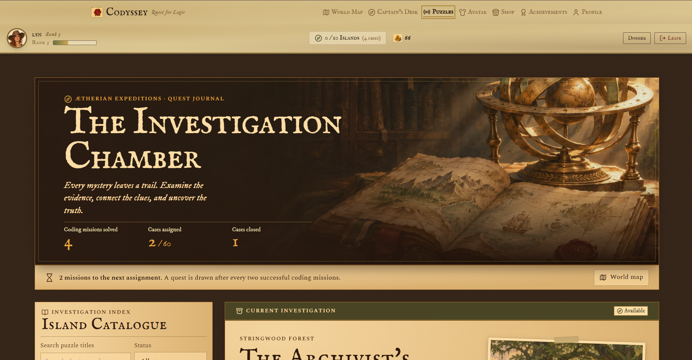
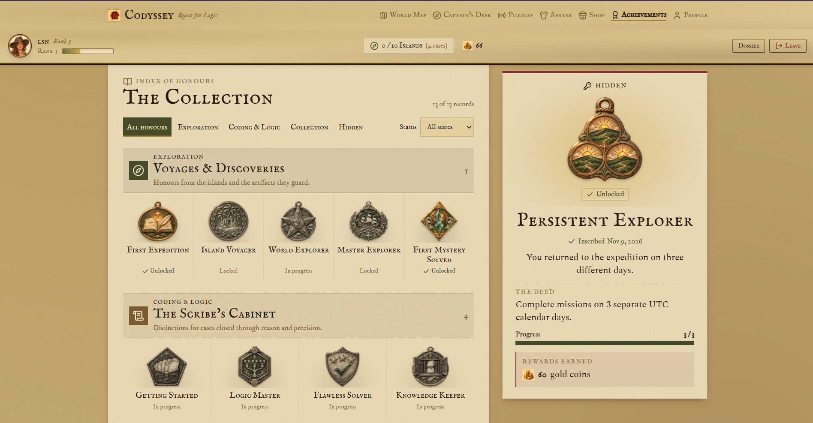
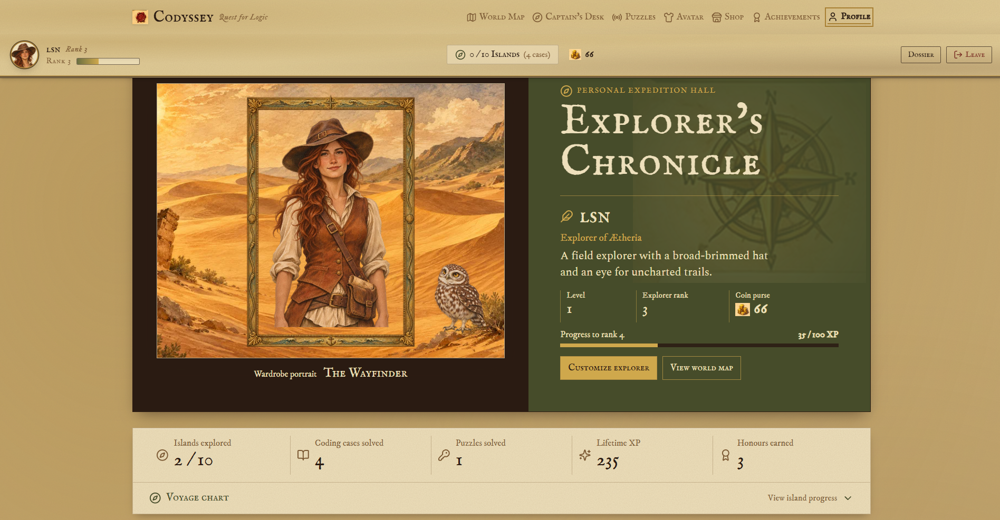
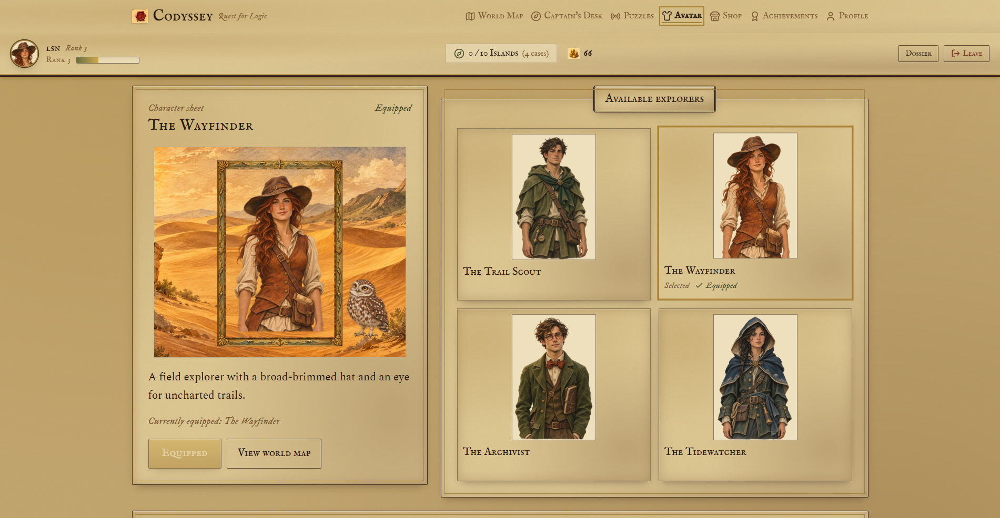
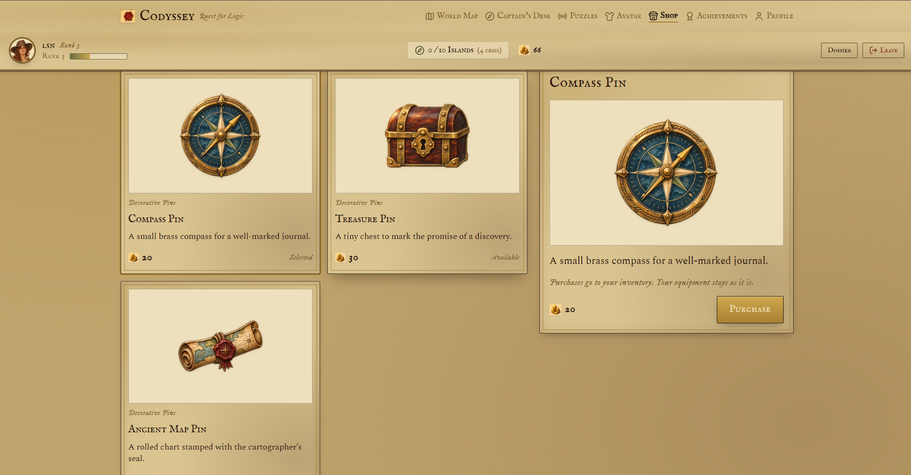

# Codyssey – Quest for Logic 🏝️

A little different from the usual way of learning DSA!

**Codyssey** is a detective-adventure game where you explore different islands, solve coding problems, uncover clues, and collect rewards along the way. Each island focuses on a different Data Structures and Algorithms topic, with challenges that get progressively harder.

The idea behind building this was simple: what if practising DSA felt a little more like going on an adventure than solving a list of questions?

Welcome to the **Archipelago of Ætheria**!

---

## 📸 Screenshots

Here is a look at the different parts of Codyssey!

### 1. Landing Page

The starting point of your expedition.



### 2. Login

The explorer login interface.



### 3. World Map – Archipelago of Ætheria

Explore the ten islands, each representing a different DSA topic.



### 4. Island Details

Explore available missions and progress through the levels of each island.



### 5. Coding Challenges

Write and execute solutions directly in the built-in code editor using C++, Java, or Python.



### 6. Interactive Puzzles

Solve different types of puzzles and uncover clues throughout the expedition.



### 7. Achievements

Keep track of milestones and accomplishments earned during gameplay.



### 8. Explorer Profile

View your progress, statistics, inventory, achievements, and recent activity.



### 9. Avatar Customization

Choose your explorer and personalize their appearance.



### 10. Shop

Browse cosmetic items and purchase them using in-game coins.



---

## ✨ Features

- **Interactive World Map:** Explore 10 islands, each based on a different DSA topic.
- **Coding Challenges:** Solve 87 coding missions with increasing difficulty.
- **Interactive Puzzles:** Take on 60 puzzles with six different interaction mechanics.
- **Built-in Code Editor:** Write and execute solutions in C++, Java, and Python.
- **Achievements and Rewards:** Earn coins, unlock achievements, and track your progress.
- **Avatar Customization:** Choose an explorer avatar and purchase cosmetic items using earned coins.
- **Explorer Profile:** View coding statistics, puzzle progress, achievements, inventory, and recent activity.
- **Progression System:** Unlock levels within each island as you complete previous challenges.

## 🗺️ The Archipelago

Codyssey features 10 islands:

| Island | DSA Topic |
|---|---|
| Array Archipelago | Arrays |
| Stringwood Forest | Strings |
| Linked Isles | Linked Lists |
| Stack & Queue Depths | Stacks and Queues |
| Sorting Sands | Sorting |
| Searching Peaks | Searching |
| Tree of Secrets | Trees |
| Graphbound Kingdom | Graphs |
| Recursion Realm | Recursion |
| Dynamic Programming Dimension | Dynamic Programming |

All islands are visible on the world map. Levels within each island unlock as you make progress.

## 🎮 How It Works

1. Choose an island from the world map.
2. Open an available coding mission.
3. Solve the problem using the built-in code editor.
4. Complete interactive puzzles as they become available during your expedition.
5. Earn coins, collect rewards, and unlock achievements.
6. Keep exploring and work your way through the archipelago!

## 🛠️ Tech Stack

**Frontend**
- React
- Vite
- Tailwind CSS
- React Router
- Monaco Editor
- Motion
- Lucide Icons

**Backend**
- Node.js
- Express.js
- MongoDB
- Mongoose

**Other Technologies**
- JWT and bcryptjs – Authentication
- Judge0 – Code execution
- Axios – API requests

## 🚀 Getting Started

Want to run Codyssey locally? Follow these steps.

### Prerequisites

- Node.js and npm
- Git
- MongoDB Atlas account or a compatible MongoDB instance

### 1. Clone the repository

```bash
git clone https://github.com/shreyabadgujar/codyssey-quest-for-logic.git
cd codyssey-quest-for-logic
```

### 2. Configure environment variables

Copy the example environment file using Windows PowerShell:

```powershell
Copy-Item .env.example backend/.env
```

Add the required configuration values, including your MongoDB connection URI and JWT secret.

If frontend environment variables are required, create `frontend/.env` and configure the relevant `VITE_` variables.

Refer to `.env.example` for the exact variable names.

**Note:** Never commit your `.env` files or expose API keys and secrets.

### 3. Install dependencies

Run this command from the project root:

```bash
npm run install:all
```

### 4. Start the backend

```bash
npm run dev:backend
```

Backend health check:

`http://localhost:5000/api/health`

### 5. Start the frontend

Open another terminal in the project root:

```bash
npm run dev:frontend
```

Open the application at:

`http://localhost:5173`

## 🧪 Running Tests

To run the backend test suite:

```bash
cd backend
npm test
```

To create a production build of the frontend:

```bash
cd frontend
npm run build
```

## 📁 Project Structure

```text
codyssey/
│
├── docs/
│   └── screenshots/
│
├── backend/
│   ├── controllers/
│   ├── data/
│   ├── middleware/
│   ├── models/
│   ├── routes/
│   ├── services/
│   └── tests/
│
├── frontend/
│   ├── public/
│   └── src/
│       ├── components/
│       ├── data/
│       ├── hooks/
│       ├── layouts/
│       ├── pages/
│       └── styles/
│
├── API_CONTRACT.md
├── AGENTS.md
├── package.json
└── README.md
```

---

*Every island holds a mystery. Every challenge reveals a secret.* 🧭